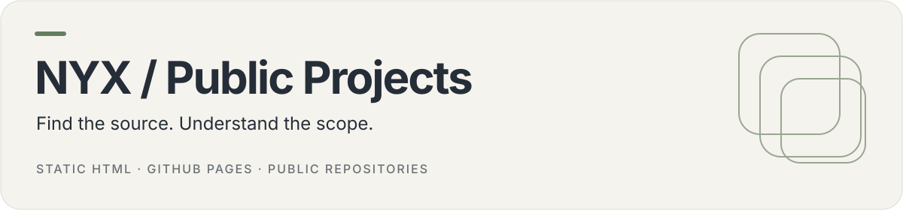

<p align="center">
  
</p>

# NYX / Public Projects

The public project directory at **https://coding-nyx.github.io/**. It brings together coding-nyx's original apps, developer tools and board software, with clearly attributed upstream forks and a separate archive section.

[Visit the directory](https://coding-nyx.github.io/) · [Portfolio](https://iamnyx.web.app) · [Project profile](https://github.com/coding-nyx)

## What it contains

| Section           | Purpose                                                                           |
| ----------------- | --------------------------------------------------------------------------------- |
| Original projects | Eight project cards, including Tally, Forge CLI and the current Hermes companions |
| Find/filter       | Text search and Apps / Tools / Systems filters                                    |
| Forks             | Armbian and OpenClaw forks with upstream credits                                  |
| Archived work     | Four public archived repositories, clearly labeled                                |

This is a static directory, not a hosted runtime for the projects. Private services are linked to their public source only. The previous Ash application landing and legal pages have been retired.

## Run locally

No package installation, framework build, database or credentials are needed. Any static web server can serve the repository. For example, when deliberately starting a local preview:

```sh
python3 -m http.server 8000
```

Open the server's root page. All cards render without JavaScript; the script enhances search, categories, result counts and the empty-state reset. The page does not use browser storage or make model-provider requests.

## Deploy

GitHub Pages serves the root of the `main` branch. Push reviewed source changes and verify the resulting Pages deployment. `.nojekyll` keeps the site a plain static tree. No custom domain, app backend or separate build output is required.

## Maintain the directory

The project cards are rendered directly in `index.html`, so they remain usable without JavaScript. `projects.json` is a companion data manifest for maintenance; it is not fetched at runtime. Keep the two in sync when changing cards, then update the summary counts and fork/archive sections as needed.

Before adding a link, verify that the repository is public and its status is correct. Do not publish private application URLs, personal records or credentials. A fork should name its upstream, and archived projects should stay labeled.

## Files

| Path                              | Responsibility                                              |
| --------------------------------- | ----------------------------------------------------------- |
| `index.html`                      | Semantic content, cards, links and archive disclosure       |
| `styles.css`                      | Responsive layout, focus states and reduced-motion handling |
| `script.js`                       | Search/category filtering and empty-state reset             |
| `projects.json`                   | Companion project manifest                                  |
| `favicon.svg`                     | Small project-directory identity                            |
| `docs/assets/readme-overview.svg` | README banner                                               |

## Check changes

- Inspect desktop, tablet and phone layouts, including narrow screens.
- Exercise search, each category, no-result handling, reset and keyboard focus.
- Check source/upstream links and verify no deleted or private repositories are advertised.
- Check JavaScript syntax with `node --check script.js`.
- Run `git diff --check`, then verify the deployed Pages URL after pushing.

The browser QA for a documentation refresh does not certify the linked applications or their deployments. No top-level project license file is present.
